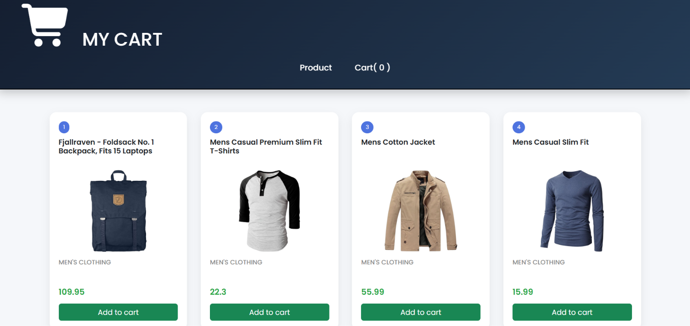
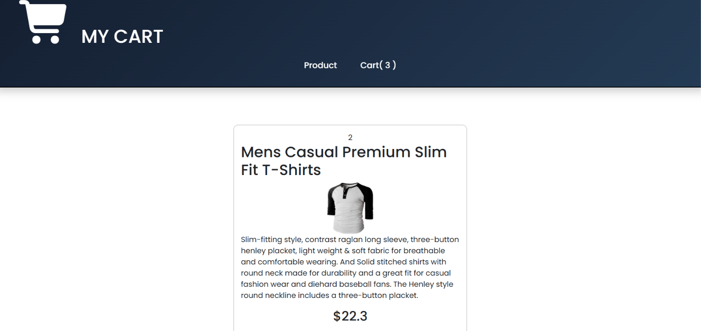
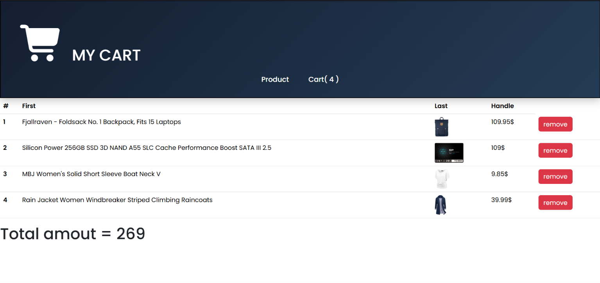
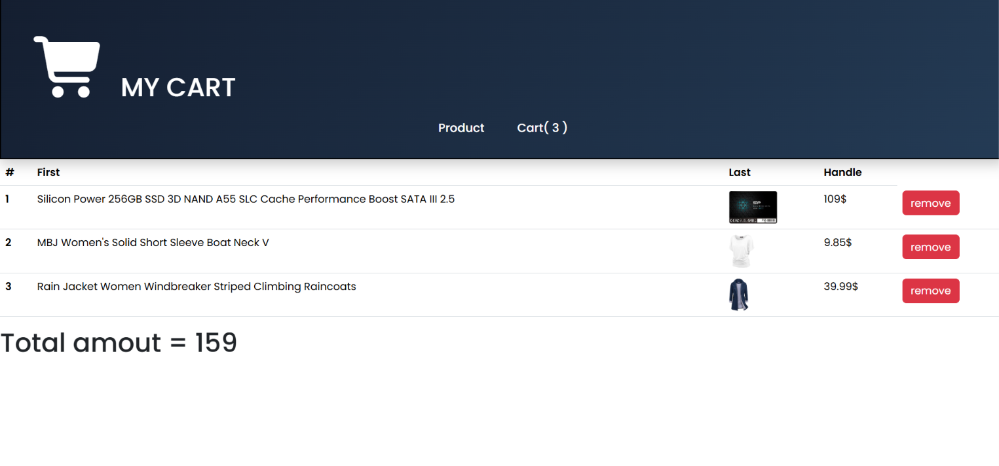

# 🛒 React Add to Cart

A dynamic shopping application developed using **React.js** that allows users to browse products, explore product details, and manage their shopping cart. This project demonstrates practical implementation of React concepts, component-based architecture, routing, and API integration.

## 📌 About the Project

React Add to Cart is a frontend shopping application designed to provide a simple and user-friendly online shopping experience.

Users can explore products, view individual product information, add products to their cart, and remove items when needed. The application is developed using React functional components and React Hooks.

## 🚀 Features

- **User Authentication UI:** Login and Signup pages.
- **Home Page:** Displays the shopping application homepage.
- **Product Listing:** Browse available products.
- **Product Details:** View individual product information.
- **Read More:** Explore additional product descriptions.
- **Add to Cart:** Add selected products to the shopping cart.
- **Remove Items:** Remove unwanted products from the cart.
- **Navigation:** Navigate between different pages using React Router.
- **Dynamic Rendering:** Display product information dynamically.

## 🛠️ Technologies Used

| Technology | Purpose |
|---|---|
| React.js | Building user interfaces |
| JavaScript (ES6+) | Application functionality |
| HTML5 | Web page structure |
| CSS3 | Styling and layouts |
| React Router DOM | Page navigation |
| Axios | API integration |
| Vite | Development server and build tool |

## 📸 Application Screenshots

### 1. Login Page


### 2. Home Page


### 3. Product Details


### 4. Read More Page


### 5. Shopping Cart


### 6. Item Removal


## 📂 Project Structure

```text
React-Add-To-Cart/
│
├── README.md
├── .gitignore
│
├── screenshots/
│   ├── login.png.png
│   ├── Home.png.png
│   ├── details.png.png
│   ├── readmore.png.png
│   ├── cart.png.png
│   └── item_removal.png.png
│
└── addtocart/
    ├── public/
    ├── src/
    │   ├── Addtocart/
    │   │   ├── Cart/
    │   │   ├── Home/
    │   │   ├── Login/
    │   │   ├── Navbar/
    │   │   ├── Product/
    │   │   ├── Readmore/
    │   │   └── Signup/
    │   │
    │   ├── App.jsx
    │   ├── App.css
    │   ├── index.css
    │   └── main.jsx
    │
    ├── package.json
    ├── package-lock.json
    └── index.html
```

## ⚙️ Installation and Setup

Follow these steps to download and run the project on your local machine.

### Step 1: Clone the Repository

```bash
git clone https://github.com/anandakrishnan8803/React-Add-To-Cart.git
```

### Step 2: Navigate to the Project Directory

```bash
cd React-Add-To-Cart/addtocart
```

### Step 3: Install Dependencies

```bash
npm install
```

### Step 4: Start the Development Server

```bash
npm run dev
```

### Step 5: Open in Browser

Open the localhost URL displayed in your terminal to view the application.

## 📚 Concepts Practiced

During the development of this project, I practised the following concepts:

- React Functional Components
- Props and State Management
- React Hooks (`useState`, `useEffect`)
- Component Reusability
- React Router DOM
- API Fetching and Integration
- Axios
- JavaScript Array Methods (`map`, `filter`)
- Event Handling
- Conditional Rendering
- CSS Styling

## 🎯 Project Objective

The main objective of this project was to gain practical experience in React.js by developing a shopping application.

It helped me understand how different React components communicate, how application data is managed, how routing works, and how to build interactive frontend applications.

## 👨‍💻 Developer

**Anandakrishnan Aji**

Full Stack Developer | MERN Stack Developer

- GitHub: [@anandakrishnan8803](https://github.com/anandakrishnan8803)
- Repository: [React Add to Cart](https://github.com/anandakrishnan8803/React-Add-To-Cart)

---

⭐ If you find this project interesting, please consider giving it a star!

**Thank you for visiting my project!**